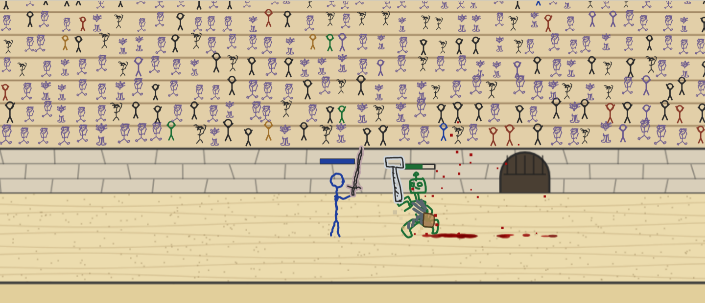

# Stick Men Wars

Draw your own army of stick men, stones, catapults and weapons, then watch them hack each other to bits. Or draw one gladiator, armed and armored as you like, and send it into the arena. Play the computer or a friend.




## Starting a game

Pick **war** or **gladiators**, then **vs computer**, **two players** to fight a friend on their own device, or with gladiators a **tournament** for up to eight: the invite button in the bar shows a code, and their phone, pointed at it, is seated straight away. Under them, a smaller button (a trophy, a weapon rack and a crowd) opens one page with a tab for each: the **hall** of gladiators that have won, the **armory** of every weapon drawn, and the **crowd** of every stick man drawn. The TV button beside it is for a big screen (below).

Every drawing page works the same way. The check mark (or Enter) keeps a drawing if it passes a quick shape check, and says what's missing if it doesn't. The curly arrow undoes a line (Z), the eraser clears the page (C), the arrow to the bar moves on (N). The dashed drawing shows what's wanted. A pen that slides off the page lifts there, and draws on again where it comes back.

## War

### Drawing your army

Five pages, each against the clock. Draw as many as you like on each. A page left with nothing kept gets the defaults, drawn by a shaky hand.

| What | Time | The check |
| --- | --- | --- |
| Stick men | 45s | a roundish closed head on top, a body hanging from it, arms and legs sticking out both sides, not a scribble |
| Stones | 25s | one closed, lumpy outline |
| Beams | 25s | long and thin, at least three times as long as it is wide |
| Rocks | 25s | a closed, round-ish lump: bigger hits harder and spikier tears more, but a heavy one flies shorter and takes longer to load. Each one kept is a rock on your catapult's pile (10 at most) |
| Weapons | 40s | anything with some size to it, inside the box on the page, handle at the bottom |

A weapon is drawn in the box on its page (the pen lifts at the box's edge), and its shape is how it fights: length is reach, width and ink are weight, jagged edges shred and bleed, a thin blade cuts cleaner. Any shape will do: a big clunky one hits hard but swings slowly and slows the man carrying it. Each gets a name: Shredder, Bone Crusher, Skewer, Shiv or Blade. Skewers stab. The rack button on the page borrows one from the armory instead.

Drawing more pays. Every army has 10 men, and each different stick man and weapon you draw past the first of each adds one more man (6 more at most). Different means it: a stick man in a new pose (arms up, legs wide, a big head), a weapon of a new shape. A copy of one you've kept still fights, but earns nothing, and shows faded among what you've kept. Each stone past the first raises your wall a row (6 rows, up to 9), and five stones or more make it a stone thicker. Only what you draw counts: the defaults and borrowed weapons earn nothing.

Against a friend, each draws their own army. Against the computer, it draws itself a different one by a shaky hand (its own stick men, lumpy stones, logs and planks, eggs and maces for its catapult, spears, maces, clubs, double axes and saw-toothed swords, and a couple of weapons from the armory), a new one each time you draw yours. It fights with 13 men and a wall 7 rows high, and plays each battle its own way: a steady trickle of men; a rush, nearly everyone at once; dug in behind its wall with men on top until your side's thinned; a siege, battering your wall before it comes; or in waves of four.

### Orders

The field runs back into the page: men, catapults and rubble stand nearer or further, and men cross the field to meet whoever they fight. Each side has a wall of its stones, a catapult of its beams, and its army standing in rows at home behind the wall from the start, one of them crewing the catapult. Each man is one of the side's drawings, carrying one of its weapons. Every man has a job, and choosing them is the game:

- **Fight**: the running man (Space) sends them charging; the shield (H) has them hold just outside your wall; the tent (B) brings them home.
- **Shoot**: crew the catapult with the catapult button (C) then a tap on it, or with men picked, just tap it. It only fires with crew at it, loads faster with up to three, and sends its crew home once its last rock is thrown. Over it: whether it's aimed (the target, red until it is), its rocks, its crew (red when nobody's at it), and a hammer while it's being repaired.
- **Aim**: T, or tap anywhere on your catapult (even past its crew): see below.
- **Repair**: the hammer button (R), then tap the catapult or your wall; or with men picked, tap your wall. Repairers patch cracked stones and set new ones into the wall's gaps, mend a damaged catapult, and even rebuild a smashed one from its wreck, slowly, to fight on with whatever rocks it had.

**Picking men**: tap one, or drag a box around several (the dashed box button, A, picks everyone; Esc lets go). The count of who's picked sits by the buttons. With nobody picked, fight orders go to everyone not crewing or repairing. Tapping past your wall with men picked sends them charging.

### Rocks and aiming

The catapult throws only rocks you drew, each once. The ones drawn before the battle start on its pile, lying in front of it, each as you drew it. More can be drawn during the battle: the rock button in the corner of the field (D) opens a small pad, and a rock kept there goes on the pile. You get 10 rocks a battle all told; the button shows how many are left to draw, and wiggles when the catapult has nothing to throw. A rematch starts with the rocks drawn before the battle again. The computer draws its own as it goes.

Tap your catapult (with no men picked) and an aiming pad opens in the middle of the screen. Pull back from its centre like a slingshot: the further, the farther, and the field shows where the next rock would land. It throws only forward, between a low and a steep angle (the shaded wedge on the pad), and at most into the enemy's wall, never over it: the edge of the pad is as far as it reaches, so men at home behind a wall are safe from rocks (one that rolls over the top drops dead behind it). Let go, and that's its aim: from then on it fires that way by itself as often as it can, its aim drawn as a dotted arc. Aim it again any time; the pause on the pad holds its fire. Dragging straight from the catapult aims it too.

### Walls, blades and blood

The walls are real stones: each block is one of the side's stone drawings, its outline its shape, stacked and resting. A boulder knocks stones loose, and whatever loses its support falls the way its shape makes it fall. A stone takes a battering by its shape (a fuller, blockier one takes more), then cracks into rubble. Men climb rubble a stone high at a time, and hack at what's taller.

Men charging march at the nearest enemy and fight; the rest fight whoever comes close. Blades only reach men in about the same lane, and cut where they actually pass: arms, legs, heads, or a torso in half. A head or a torso cut off kills; a lost leg leaves a man crawling until he bleeds out, and he no longer counts; a man with no arms left can't fight, and bleeds out. Cut-off parts fly, stumps spurt, and a boulder landing on someone flattens them. Blades fall from dead hands and get bloodier as they're used.

So the field stays readable, the dead, cut-off parts, rubble, dropped weapons and fallen stones lie a while, then fade away (a fallen stone stops being in anyone's way as it goes). The blood stays.

### Winning

The last side with anyone standing wins. Then fight again with the same armies (the circling arrows), or draw new ones (the pencil). If a player's page closes, their drawing clock and the battle wait for them. If they leave the game (the door, which asks first: the curly arrow stays, the red door goes), their side is free for the next person to join, who draws their own army.

## Gladiators

### Drawing your gladiator

Four pages: your gladiator (one stick man, a minute), its weapon (in the box, as for an army, 50 seconds), then armor (a minute) and a shield (45 seconds) if you want them: leave either page empty to fight without. Armor is drawn right over your gladiator, shown faintly on its page; a shield beside it, its size against your gladiator's being its size in the arena. Each page takes one drawing: keep it and it's on to the next page. The gladiator's own page can't be skipped: draw one, or enlist one from the hall (the trophy). The weapon can be borrowed from the armory instead.

### The fight

The two walk out of their gates into the arena, sand underfoot and a packed crowd in the stands (the stick men players have drawn) that erupts when a limb flies off, roars at a kill, gasps at a big blow or a shield smashed, and boos whoever's told to back off. They fight it out by themselves, each its own way, all of it from how it was drawn:

- **Its body**: long legs walk faster and long arms reach further, but a spindly gladiator is frailer (less in him, limbs that come off easier) and a long arm swings slower; a stubby one is sturdier.
- **Its weapon**: as in a war, reach from length, weight from width and ink, shredding from jagged edges; a long, not too heavy one is fought from the end of its reach.
- **Armor**: each part of it (helmet, chest, arms, legs) takes some of a blow landing there, the more of that part it covers, and spares that part from being cut off. Heavy armor is knocked about less, but slows.
- **A shield**: catches some of the blows that come from in front, the bigger the more, and the gladiator strikes straight back off a block. It weighs, and it breaks after enough of a battering.
- **Light all over**: darts in to strike and out again, and slips blows more often.

A gladiator is tough: a duel is many blows, and no blow kills outright. A bar over each shows how much it has left.

### Cheering it on

Three big doodles under the arena, each shout holding for three seconds, shown over your gladiator while it does:

- **Charge** (Space): in at them, swinging sooner and hitting harder, but recklessly: it slips and blocks fewer blows.
- **Back off** (B): out of reach to catch its breath: no swinging, but its bleeding slows, a little health comes back, and it slips blows more often.
- **Shield up** (H): it stands its ground and only strikes back, blocking and slipping more; a blow caught or slipped earns a harder one back.

The computer cheers its own gladiator on the same way.

### Yield, medics and the verdict

Beaten down (badly hurt, or a leg gone), a gladiator yields: on his knees, the fight stopped, the winner standing over him. Two stick medics run out of his gate: one slaps his face to bring him round, the other picks up every limb he lost from the sand, carries it back and slaps it on, so he's whole to be judged. Then they stand back, the crowd hushes, and a thumb over him tilts slowly back and forth, up, sideways, down, as it makes up its mind... then it slams down: **thumbs up**, and he's spared, or **thumbs down**, and he's drawn and quartered, his arms and legs torn off one by one while the medics run for the gate. The crowd judges mostly by the fight it just watched: how badly he hurt the winner, and how long he lasted. His record in the hall only nudges it, and now and then it spares one on a whim.

Fight again (the circling arrows) with the same gladiators, unless one was quartered: the computer sends another, and a player who lost draws a new one. Walking out of a duel (the door asks first, a skull showing what it costs) loses it.

### A tournament

Up to eight players, each on their own phone: the first opens a tournament, the others join it from the invite code (or the tournament button, while one's gathering). Each draws a gladiator on their own pages, at their own pace, and sees who else is still drawing; once two or more are drawn and nobody's still at it, the first player starts it (the bracket doodle). The gladiators are drawn into pairs at random (an odd one out has a bye), and the duels are fought one at a time in the arena, everyone watching, the two fighters' players cheering theirs on. The crowd judges every loser as ever, but a loser's out either way, and the winners go through to the next round, until one is left: the champion. Between duels a card shows the bracket, each gladiator drawn, the winners ringed and the beaten crossed out. Then a new bracket with the same gladiators (the circling arrows), or everyone draws a new one (the pencil). A player who leaves loses the duel they're in, and the next one they'd have fought is a walkover.

### On the TV

For game night, open the game on a TV or a laptop everyone can see and tap the TV doodle on the start page (or go to `#/tv`). It waits for a game to start in the house, then watches it, everything drawn bigger: while people are still drawing it shows the code their phones scan to join, a tournament's bracket stays pinned in the corner through the duels, and when one game is over and everyone's left it moves on to whatever's on next. A tournament, when one starts, always takes the screen.

### The hall

Every gladiator that wins is kept in the hall of gladiators, with its record, and the computer sends them back into the arena against whoever plays it next (the better its record, the likelier); one of them shows its wins by its flag. A loser the crowd spares keeps its place in the hall, or earns one; one it gives the thumbs down is struck from it. With nobody in the hall yet, the computer draws its own.

A gladiator that wins three times earns a name, made from what it is: heavy armor makes it a Tin Can, a big shield a Shield-Wall, long limbs Stick-Legs, a crushing weapon a Bonecruncher. Its name shows on its card, over it in the arena, and on the end card.

The **hall** tab shows everyone in it, best record first: each drawn with its armor and shield on, with its wins and losses, but no weapon, because a gladiator can be handed any weapon. Tap one to fight it: draw your gladiator, and that one walks out of the other gate.

Or fight *as* one: on the warrior's page the trophy button opens the hall, and the gladiator you tap is yours, its armor and shield with it. Then choose its weapon, drawn or borrowed from the armory. Its record carries on: a win is its win, and if the crowd gives it the thumbs down, it's struck from the hall. The computer sometimes hands its hall gladiators a different weapon from the armory too.

## Shared by every game

### The armory

Every weapon a player draws, in a war or for a gladiator, goes into the armory (one that looks and handles like a weapon already there doesn't go in twice), alongside the computer's own war weapons (its spear, mace, club, double axe and saw-toothed sword) and the default axe and sword. Each is counted in every battle it fights and for every man it kills, whoever swings it: a weapon drawn like one already there, the computer's, or a default all count as that one. In the arena, a duel won is a kill for the winner's weapon, whether the crowd spares the loser or not. A weapon that kills five earns a name from its shape (a shiv is a Toothpick, a crusher a Mallet) and its strongest trait (of Crushing, of Far Poking, of Shredding). Players borrow from it on a weapon page, and the computer arms itself from it too, better-loved and deadlier weapons more often. The **armory** tab shows every weapon in it with its thumbs and kills: give each a thumbs up or down (one thumb each, tap again to take it back), and sort them by the most loved, the most hated, the most controversial (many votes, split down the middle) or the deadliest.

### The crowd

Every stick man a player draws (one standing too like one already there doesn't go in twice) joins the crowd, and the crowd fills the arena's stands: the gladiators fight in front of your own drawings, standing, hopping, throwing their arms up. The **crowd** tab shows them all: thumbs up or down on each, sorted by the most loved, the most hated or the most controversial; the better loved, the more seats they fill.

## Looking around

On a small screen (a phone) the battle is zoomed in so the men stay readable, starting over your own side: two fingers pan along the field and pinch to zoom. On a computer, the scroll wheel zooms and the arrow keys pan. Held upright, a phone shows the whole battlefield in a strip across the top, with what the main view shows boxed on it: tap or drag along the strip to look there. In the arena, the view follows the two gladiators, wide enough to keep both in sight.

## Running it

A multiplayer web game on [web-game-framework](https://github.com/fatlard1993/web-game-framework) and [@vanilla-bean/components](https://github.com/fatlard1993/vanilla-bean-components), its walls on [planck.js](https://github.com/piqnt/planck.js).

```sh
bun install
bun run dev    # http://localhost:3000, rebuilding and reloading as files change
bun test
bun run build && bun start    # production
```

Anyone on the network can join from the invite code, and the lobby at `#/hub` lists every game to watch. Kept between restarts in `data/`: `games.json` (the games, with their art), `gladiators.json` (the hall), `weapons.json` (the armory) and `crowd.json` (the crowd). How the code is laid out is in `CLAUDE.md`.
